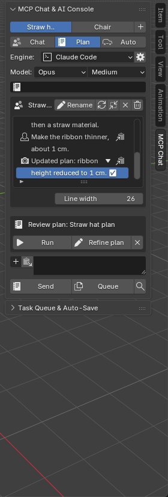
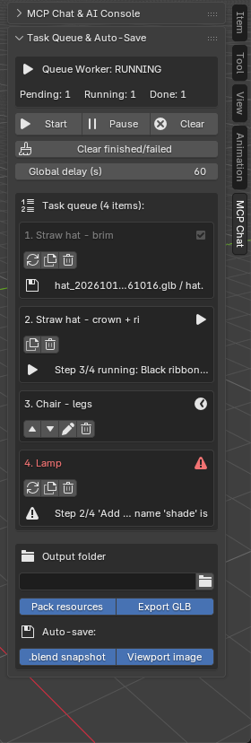

# 🧊 MCP Chat for Blender  `v0.8.6`

[English](README.md) | [한국어](README.ko.md) | **中文** | [日本語](README.ja.md)

这是一个 Blender 插件，可以让你**在 3D 视口中与 AI 对话，让 AI 帮你制作 3D 模型。**
在 N 面板的聊天窗口中直接使用 Claude Code、Codex、agy CLI、OpenRouter 等多种 AI 引擎，AI 生成的 Python（bpy）代码会通过任务队列安全地执行并自动保存。

> ## ⚠️ 提示（未完成的部分）
> **我尝试在 Blender for Android（非官方版本）上通过 Termux 使用 Claude，但该集成尚未完成。**
> 由于应用沙盒限制，Android 版 Blender（APK）无法直接运行 Termux 中安装的 `claude`，因此插件附带了一个在 Termux 中运行的中继服务器（`termux_agent.py`）。代码和安装脚本已包含在内，但**我没能在真实的 Android 设备上确认它能完整运行。**
> 目前确认可正常工作的环境只有 **Windows PC 上的 Blender + 同一台 PC 上安装的 Claude Code**。Codex CLI、agy CLI 以及 macOS/Linux 只编写了代码，尚未验证。

> ## 🚨 API 密钥安全警告
> - **请使用设有消费上限的专用密钥**（单独的密钥/项目并设置预算上限）。切勿使用主密钥或生产密钥。Auto 模式可能发送大量请求，**本插件不会限制你的花费。**
> - 密钥**加密保存在插件文件夹内（`.vault/`）**，并**随插件一起删除**——但加密只是**尽力而为**：它能防止截图、复制文件等意外泄露，**不能**防御恶意程序或能以你的身份登录的人。在没有 `openssl` 的 Android 上只是弱混淆。
> - **切勿分享** `.vault/` 文件夹、设置界面的截图或旧备份（旧版本以明文保存密钥）。如果密钥可能已泄露，请**立即在服务商处吊销。**
> - **通过替换插件文件夹来更新会清除密钥**；保险库丢失后密钥无法恢复。详情见[第 8 章](#8-api-密钥保存注意事项重要)。
> - 使用 Claude Code / Codex / agy CLI 或网页界面时**不需要** API 密钥（它们使用各自的登录）。

---

## 1. 用途

- 在 Blender 中用日常语句（例如“照这张照片做一顶帽子”）让 AI 完成 3D 建模和材质。
- AI 生成的代码不会被直接执行：它们进入**任务队列**，按顺序运行，每次成功后自动保存 `.blend`、`.glb` 和视口图片。
- 可以**先审阅计划（Plan）**，满意后再执行，或继续修改。

## 2. 功能概览

| 类别 | 内容 |
|---|---|
| **AI 引擎** | Claude Code（默认）、Codex CLI、agy CLI、Direct API（OpenRouter · NVIDIA NIM · 本地 Ollama · 自定义） |
| **模型 / 推理强度** | 在 N 面板中按引擎选择模型（下拉 + 自定义 ID）和推理强度 |
| **模式** | Chat（对话并执行）/ Plan（制定计划后审阅）/ Auto（计划 + 自动执行） |
| **计划审阅** | 计划生成后可选择**执行 · 继续规划 · 取消** |
| **任务队列** | 添加、编辑、删除、调整顺序（▲▼）、重试、复制；全局延迟（默认 60 秒）；一条指令 = 一个队列任务 |
| **自动保存** | 每次任务成功后保存 `.blend`（打包资源）+ `.glb` + 视口 PNG，可指定保存位置 |
| **聊天** | 最多 3 个会话标签页、多行可滚动历史、压缩/清空、复制消息 |
| **图片附件** | 本地图片或视口快照，最多 3 张（小预览），AI 会参考它们 |
| **提示词检查** | 发送前**预览**最终提示词，发送后查看**实际发送的提示词**（Auto 模式包含 AI 的计划） |
| **AI 规则编辑** | 在插件设置中编辑/恢复内置的 *Blender Execution Rules* |
| **更新** | 在插件设置中检查并安装最新的 GitHub Release |
| **用户准则** | “倒角 2 段；倒角面应用黑色顶点色”之类的准则会应用到每个任务 |
| **内置安全规则** | 不添加未要求的灯光/相机，保留现有对象，新建集合存放新作品，只准备渲染而不执行 |
| **API 密钥安全** | 密钥/令牌加密保存在插件文件夹内（随插件删除）— 见[第 8 章](#8-api-密钥保存注意事项重要) |
| **MCP 服务器** | 在 Blender 内运行 MCP/网页服务器，Claude Code 等可通过 `execute_blender_code`、`get_scene_info`、`capture_viewport` 控制 Blender |
| **网页聊天界面** | 在浏览器（PC/手机）中使用相同的会话和队列 |
| **语言** | 한국어 · English · 中文 · 日本語 |
| **Blender 支持** | 3.x 及以上（任何支持 MCP 的 AI 客户端都可连接；并未在所有版本上验证） |

## 3. 安装

1. 从 [Releases](https://github.com/refleAct/mcp-chat-for-blender/releases) 下载 **`mcp-chat-for-blender-vX.Y.Z.zip`**。
   - ⚠️ **请勿使用 GitHub 的 “Source code (zip)” / “Download ZIP”。** 其文件夹名包含版本号中的点（`.`），Blender 安装后会报 `No module named 'mcp-chat-for-blender-0'`。务必使用 Release 中附带的 zip。
   - 自行打包：`python package_addon.py --ci` → `dist/mcp-chat-for-blender-vX.Y.Z.zip`
2. Blender：**Edit › Preferences › Add-ons › Install from Disk…** → 选择 zip → 勾选启用。
3. 在 3D 视口按 **N 键 → `MCP Chat` 标签页**。
4. （可选）连接 Claude Code：在插件设置中点击 **Claude Code MCP 自动注册**，并在 PC 上安装 `claude` CLI。

> 🔑 **更新**请使用插件设置中的 **检查更新 → 安装更新**，这样会保留已保存的密钥。如果用“覆盖”方式重新安装 zip，插件文件夹会被替换，**已保存的 API 密钥会被删除**（见[第 8 章](#8-api-密钥保存注意事项重要)）。

### 支持的 Blender 版本

| 版本 | 状态 |
|---|---|
| Blender 3.x | 支持（插件最低版本 3.0），看起来可以正常工作 |
| Blender 4.x 及以上 | 支持（在 5.2.2 上确认了安装、启用和界面显示） |
| Android 版 Blender（非官方） | 实验性 — 见上方提示 |

- 外部 AI 通过 **MCP（Model Context Protocol）** 连接 Blender，因此只要是支持 MCP 的 AI 客户端，与 Blender 版本无关都可以连接。
- 但**并未在所有版本上验证**，不同版本的界面行为可能略有差异。导出 GLB 需要启用 Blender 的 glTF 插件。
- 无需任何外部 Python 包（仅使用标准库）。

## 4. 使用方法

### 4-1. 基本流程
1. 在 N 面板的 **MCP Chat** 标签页选择 **Engine**（默认 Claude Code）以及**模型 / 推理强度**。
2. 选择模式。**默认是 Auto**（计划 + 自动执行）。如果想在执行前先审阅计划，请选择 **Plan**。
3. 输入提示词并点击 **Send（发送）**。（`+` 按钮附加图片，剪贴板按钮粘贴文本。）
4. 进度和结果显示在聊天历史中（工作时显示 `⏳ …` 行，完成后显示 `✅`）。



### 4-2. 聊天历史
- 长消息会换成多行显示，用鼠标滚轮或滚动条查看更早的对话。
- 消息第一行的按钮：▼ 展开、复制、**查看已发送的提示词**。
- 标题处的小按钮：刷新 / **压缩**（把旧对话合并为一条摘要）/ **清空** / 删除会话。
- **行宽（Line width）** 设置控制换行位置（中日韩字符按 2 列计算）。如果行中间出现 `...`，请调小该值。

### 4-3. Plan → 审阅 → 执行
1. 以 **Plan** 模式发送，AI 会写出分步计划。
2. 输入框上方会出现**计划审阅**框：
   - **执行**：把已批准的计划作为 1 个任务加入队列并执行
   - **继续规划**：输入修改或补充要求，重新编写计划
   - **✖**：放弃计划

### 4-4. 任务队列
- 通过 **Auto** 模式或 **Queue（加入队列）** 按钮把任务放入队列。
- 每个条目都有状态图标（等待/执行中/完成/失败）、▲▼ 调整顺序、编辑、重试、复制、删除。
- 在底部设置**保存位置**、**打包资源**、**导出 GLB** 和**自动保存**开关。



> 截图来自真实的 Blender 5.2.2 英文界面，不同版本可能略有差异。

### 4-5. 用户准则
把准则写在聊天下方的输入框中，会应用到**每个任务**。多条准则用 `;` 分隔。
例：`倒角 2 段; 倒角面应用黑色顶点色`

### 4-6. 服务器 / 网页界面
- 在插件设置中启动服务器后，可以在 `http://127.0.0.1:8000` 使用网页聊天界面。
- **网页界面无需 API 密钥：** 未设置密钥时会自动使用已安装的 CLI（依次为 Claude Code、Codex、agy）。只有想用 Direct API 时才需要在 ⚙ 设置中填写密钥。
- Claude Code 等外部 AI 通过 `http://127.0.0.1:8000/mcp` 控制 Blender。

### 4-7. 通过 MCP 把你自己的 AI CLI 连接到 Blender（手动设置）

最简单的方法是使用插件设置中的 **MCP 自动注册** 按钮。如果想自己来，有三种方式。无论哪种，都要**先在 Blender 中启动服务器**，并把插件文件夹内的桥接脚本 `mcp_bridge.py` 作为 stdio 命令使用：

```
<Blender scripts>/addons/mcp-chat-for-blender/mcp_bridge.py
Windows 示例: C:/Users/<用户名>/AppData/Roaming/Blender Foundation/Blender/<版本>/scripts/addons/mcp-chat-for-blender/mcp_bridge.py
```

**A. 运行 CLI 自带的命令**

| CLI | 命令 | 检查 |
|---|---|---|
| Claude Code | `claude mcp add -s user blender -- python "<路径>/mcp_bridge.py"` | `claude mcp list` |
| Codex CLI | `codex mcp add blender -- python "<路径>/mcp_bridge.py"`（较新版本） | `codex mcp list` |
| agy | （命令未确认 — 请用 B） | — |

**B. 自己修改配置文件**

- Claude Code — `~/.claude.json`：
  ```json
  { "mcpServers": { "blender": { "command": "python", "args": ["<路径>/mcp_bridge.py"] } } }
  ```
- Codex CLI — `~/.codex/config.toml`：
  ```toml
  [mcp_servers.blender]
  command = "python"
  args = ["<路径>/mcp_bridge.py"]
  ```
- agy — `~/.gemini/config/mcp_config.json`（插件写入的文件）：与 Claude Code 相同的 `mcpServers` JSON 格式。

**C. 用提示词让 CLI 来做**

> 请注册一个名为 `blender` 的 MCP 服务器，通过 stdio 运行 `python <路径>/mcp_bridge.py`。

CLI 会根据自己的版本选择合适的命令。请让它在执行前先显示命令，完成后用 A 中的列表命令确认。

**测试连接**
- 运行 `python <路径>/mcp_bridge.py --check`，应输出 `OK - tools: execute_blender_code, get_scene_info, capture_viewport, …`。
- 如果 Blender 在另一台电脑上（例如从 Termux 连接的 PC），请设置环境变量 `BLENDER_MCP_URL=http://<PC-IP>:8000/mcp` 和 `BLENDER_MCP_TOKEN=<令牌>`（或写入 `~/.config/blender_mcp_chat/bridge.json`）。

> ⚠️ 本项目自己的测试中只使用过 Windows 上的 Claude Code 方式。Codex 和 agy 的步骤遵循各 CLI 的通常做法，但命令名称和文件位置可能因版本而异，请查看 `--help` 或该 CLI 的文档。

## 5. Android + Termux 集成（实验性 · 未完成）

> 此功能**尚未完成**。下面是设计的方案，尚未在真实设备上验证。

1. 在（Android 上的）Blender 中启动服务器
2. 在 Termux 中运行：`curl -fsS http://127.0.0.1:8000/termux/setup.sh | bash`
   - 下载 MCP 桥接、为 `claude`/`agy`/`codex` 注册 MCP，并启动 **Termux Agent**（`127.0.0.1:8787`）
3. 在 Blender 设置 › **Termux Agent** 中输入输出的 URL/令牌 → **测试 Agent 连接**
4. 如果 Agent 已停止，在 Termux 中运行 `bash ~/.config/blender_mcp_chat/start_agent.sh`

若想用手机的 Termux 控制 PC 上的 Blender，请开启**局域网访问**（令牌认证），在 PC 防火墙放行 TCP 8000，并使用设置界面的**复制 Termux 安装命令**。

## 6. 语言支持

| 语言 | 插件（Blender）界面 | 网页界面 |
|---|---|---|
| 한국어 | ✅ | ✅ |
| English | ✅ | ✅ |
| 中文（简体） | ✅ | ✅ |
| 日本語 | ✅ | ✅ |

- 在插件设置最上方的 **Language** 中选择：自动（跟随 Blender）/ 韩 / 英 / 中 / 日。
- 所有翻译都集中在 `i18n.py` 的一张表中，可在那里修改或添加。表中没有的文本将按原文显示。
- 工具提示、之前保存的聊天内容和 AI 回复语言不会被翻译。网页界面在侧边栏有独立的语言选择（默认：英语）。
- 本 README 提供四种语言：[English](README.md) · [한국어](README.ko.md) · [中文](README.zh.md) · [日本語](README.ja.md)

## 7. 结构

```
mcp-chat-for-blender/
├─ __init__.py          插件入口：面板、操作符、设置、聊天/队列界面
├─ blender_bridge.py    主线程安全执行、场景信息、视口截图、.blend/.glb 保存
├─ task_queue.py        队列工作进程（顺序执行、进度、自动保存、缩进修复）
├─ session_manager.py   SQLite 存储（会话、消息、队列、设置）+ 加密密钥访问
├─ llm_client.py        Direct API 客户端、Plan 提示词生成
├─ cli_runner.py        运行 claude / codex / agy、拼装提示词、调用 Termux Agent
├─ guidelines.py        AI 内置规则 + 用户准则（所有引擎共用）
├─ secrets_store.py     API 密钥/令牌加密保险库（DPAPI · openssl · 混淆回退）
├─ i18n.py              界面翻译表（ko/en/zh/ja）
├─ updater.py           GitHub Releases 更新检查/安装
├─ server.py            HTTP/MCP 服务器、网页界面和 REST API、令牌认证
├─ mcp_handler.py       MCP JSON-RPC 工具处理
├─ mcp_bridge.py        stdio ↔ HTTP MCP 桥接（供 Claude Code 等使用）
├─ termux_agent.py      在 Termux 中运行的 CLI 中继服务器
├─ install_termux.sh    PRoot 环境安装脚本
├─ package_addon.py     发布 zip 打包（--ci 用于 GitHub Actions）
├─ static/              网页聊天界面（index.html · app.js · style.css）
├─ docs/images/         README 截图
└─ .github/workflows/   发布自动化（推送 v* 标签即构建并发布 zip）
```

数据位置：`~/.config/blender_mcp_chat/`（聊天数据库、保存的 .blend/.glb/图片）。加密密钥位于插件文件夹内的 `.vault/`。

## 8. API 密钥保存注意事项（重要）

**密钥保存在哪里**
- API 密钥（OpenRouter / NVIDIA NIM / 自定义）以及局域网 / Agent 令牌**加密保存在插件文件夹内的 `.vault/`**。
- 它们**不会**写入 Blender 用户设置、`.blend` 文件或聊天数据库。设置中的输入框是只写的（显示“已保存（加密）”和删除按钮），网页 API 只返回 `********`。
- 删除插件文件夹时密钥也会一并删除。设置中的**删除所有数据**按钮会清除保险库、聊天数据库和已保存的输出（聊天数据库和输出位于插件文件夹之外的 `~/.config/blender_mcp_chat/`，因此不使用该按钮的话，卸载插件后它们仍会保留）。

**保护强度取决于操作系统**

| 环境 | 方式 | 能防止什么 |
|---|---|---|
| Windows | DPAPI（绑定到你的 Windows 账户） | 把保险库文件复制到其他电脑或其他 Windows 用户下无法解密 |
| macOS / Linux / Termux | `openssl enc -aes-256-cbc` + 保存在保险库旁的随机密钥文件（权限 600） | 防止截图、复制文件等意外泄露。**无法防御**以同一用户身份运行的恶意程序 |
| 没有 `openssl` 的 Android APK | 弱混淆（设置中会显示警告） | 仅避免被随手看到 — **请勿依赖它** |

**请特别注意**
1. **通过替换文件夹来更新会删除密钥。** 请使用内置更新（检查更新 → 安装更新），它会保留 `.vault/`。用“覆盖”方式手动重装 zip 会替换整个文件夹，需要重新输入密钥。
2. 如果保险库丢失或无法解密（更换 Windows 账户、重装系统等），**密钥无法恢复**。请在服务商处保管原始密钥，怀疑泄露时请吊销或重新生成。
3. **不要提交或分享 `.vault/`**（已在 `.gitignore` 中），也请避免分享设置界面的截图。
4. **旧版本曾以明文保存密钥**（聊天数据库和 Blender 用户设置）。新版本首次启动时会把它们迁移到保险库并删除，但**备份中可能仍留有旧副本**（例如 `userpref.blend@` 文件、复制过的数据库）。如果你分享过这些文件，请吊销旧密钥。
5. **不要把密钥粘贴到提示词中。** 提示词、AI 回复和附加图片会以**明文**保存在本地聊天数据库中，并发送给你所选的 AI 服务。Claude Code / Codex / agy 使用各自的登录，本插件不保存这些凭据。
6. 密钥通过 HTTPS 发送给服务商（本地 Ollama/LM Studio 使用 `http://localhost`）。AI 编写的代码**以你的用户权限在 Blender 内运行**，可能读取文件，请只使用你信任的 AI 服务。

**其他安全说明**
- 局域网访问默认关闭；开启后需要 Bearer 令牌。本地请求也会检查 Origin/Host。
- 本插件会**在 Blender 中执行 AI 编写的 Python 代码。** 请备份重要文件，并只在可信网络中使用。

## 9. 已知限制
- Android Termux 集成未完成（见上方提示）
- 有报告称在 Blender 文本框中**输入韩文时空格键无效**（推测是 Blender/输入法的问题）。可通过网页聊天界面或剪贴板粘贴按钮绕过。
- CLI 引擎（Claude/Codex/agy）每次请求都会开启新对话（不延续之前的对话）
- 进度以文字显示，没有旋转动画

## 10. 版本规则

- 当前版本：**0.8.6**
- **新增功能**：以 0.1 为单位递增（0.8 → 0.9 → 1.0 …）
- **修复 Bug**：以 0.0.1 为单位递增（0.8.1 → 0.8.2 … 最多到 0.8.999）
- Blender 的 `bl_info` 中以 `(0, 8, 6)` 这样的元组记录。变更记录见 [CHANGELOG.md](CHANGELOG.md)。
- 推送 `v*` 标签后，GitHub Actions 会自动构建 zip 并发布到 Releases。
- **Release 按版本累积**（旧版本会保留）。插件设置中的**检查更新**按钮会查询*最新*的 Release，如果比已安装版本新，就用它进行更新。

## 11. 来源与参考（Credits）

本项目**参考或以外部程序方式调用**下列规范、工具和服务。名称和商标归各自所有者所有，本项目与它们没有关联。

| 项目 | 在本项目中的用途 | 来源 |
|---|---|---|
| **MCP (Model Context Protocol)** | Blender 控制服务器（`mcp_handler.py`）和 stdio 桥接（`mcp_bridge.py`）是**依据公开规范（协议版本 2024-11-05）自行实现**的，未包含任何外部 MCP SDK 代码 | Anthropic · <https://modelcontextprotocol.io> |
| **Claude Code** | 作为外部 CLI 运行（`claude -p`、`--model`、`--effort`、`--permission-mode`） | Anthropic · <https://docs.claude.com/en/docs/claude-code> |
| **Codex CLI** | 作为外部 CLI 运行（`codex exec`、`-m`、`-i`、`-c model_reasoning_effort`），在 `~/.codex/config.toml` 中注册 MCP | OpenAI · <https://github.com/openai/codex> |
| **agy CLI** | 作为外部 CLI 运行（Antigravity） | Google Antigravity |
| **OpenRouter / NVIDIA NIM / Ollama · LM Studio** | Direct API 模式（OpenAI 兼容的 Chat Completions 格式） | <https://openrouter.ai> · <https://build.nvidia.com> · <https://ollama.com> |
| **Blender Python API (`bpy`)** | 插件界面、场景控制、保存 | Blender Foundation · <https://docs.blender.org/api/current/> (GPL) |
| **glTF 2.0 / glTF-Blender-IO** | 调用 Blender 内置 glTF 插件导出 `.glb` | Khronos Group · <https://github.com/KhronosGroup/glTF-Blender-IO> (Apache-2.0) |
| **ambientCG** | AI 规则中引用“AmbientCG 风格 PBR 材质”（不包含纹理文件） | <https://ambientcg.com> (CC0) |
| **Termux** | Android 集成的目标环境（实验性） | <https://termux.dev> |
| **Windows DPAPI / OpenSSL** | API 密钥加密保存（Windows 使用 DPAPI，其他系统使用 `openssl enc -aes-256-cbc`） | Microsoft · <https://www.openssl.org> (Apache-2.0) |
| **GitHub Releases API** | 插件更新检查 | <https://docs.github.com/rest/releases> |
| **Python 标准库** | `http.server`、`sqlite3`、`urllib`、`zipfile` 等（未捆绑外部包） | Python Software Foundation |

- 本仓库**不包含**任何外部库/SDK 源代码（仅使用标准库）。外部服务和 CLI 需要用户自行安装或注册。
- 由 **Anthropic Claude Code** 协作设计并实现。
- 由于插件使用 `bpy`，因此采用与 Blender 的 GPL **兼容的许可证（基于 MIT）** 发布。
- 如有遗漏或错误的来源，请通过 issue 告知。

## 12. 作者
- 作者：**refleaction**
- AI 协作：与 Anthropic **Claude Code** 共同设计并实现
- 非官方项目，与 Blender Foundation、Anthropic、OpenAI、Google 无关。

## 13. 许可证

**基于 MIT + 必须保留署名**

- ✅ 可以**修改源代码**
- ✅ 可以**再分发**（包括修改版和商业用途）
- ⚠️ **请勿更改或删除版权声明和署名。** 修改并再分发时，必须原样保留原作者（refleaction）和本许可证文本。
- 软件按**现状**提供，对于使用造成的任何问题（工程文件损坏、密钥泄露、API 费用等），作者不承担责任。

完整内容请参阅 [LICENSE](LICENSE) 文件。
